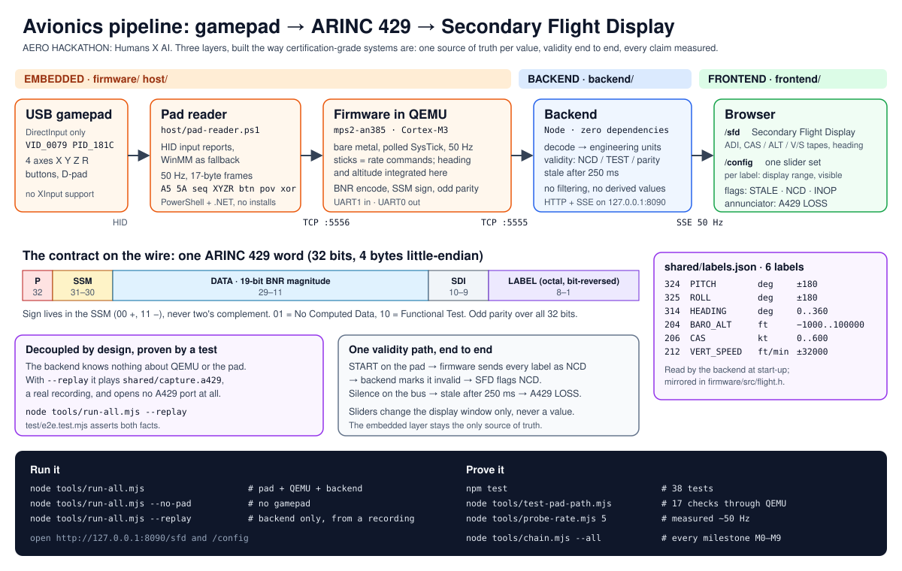
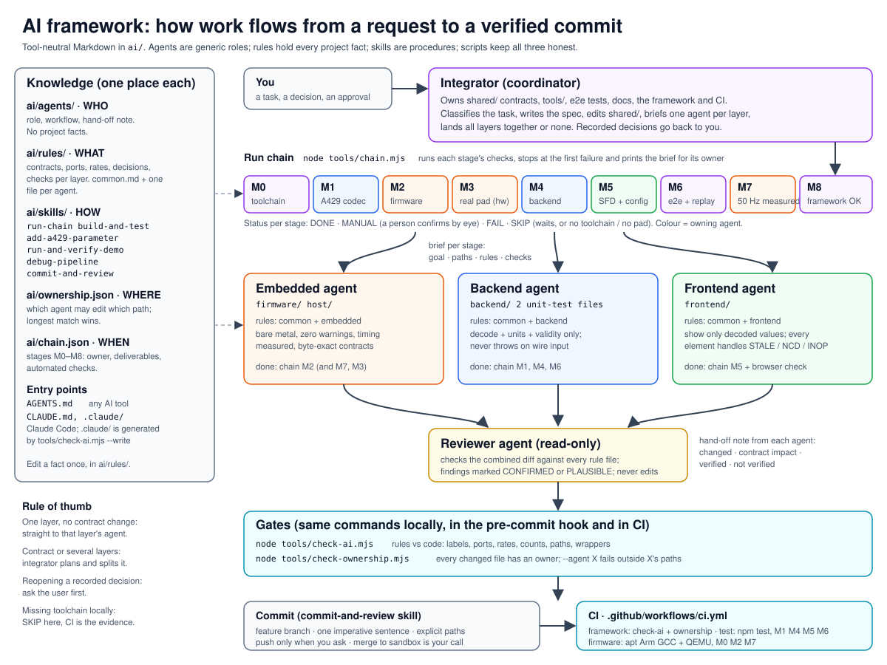

# Hackathon — Humans X AI

An end-to-end simplified avionics system: a **USB gamepad** drives **bare-metal ARM
firmware inside QEMU**, which transmits **bit-exact ARINC 429 words** to a decoupled
**backend** that decodes them and feeds a live **Secondary Flight Display**.

Built for the **AERO HACKATHON: Humans X AI** — one day, three layers, the way
certification-grade systems are put together. Organised by ASD · Skyline & Borg.

> Branch policy: **all work goes on `sandbox` first.** Nothing is merged to `main`
> without an explicit decision to do so. No `main` exists yet.

## Quick start

**Double-click `start.cmd`** (or run `npm start`). It shows a menu (gamepad,
keyboard, scripted demo or recorded replay), suggests the gamepad when one is
plugged in, waits until flight data flows, opens the flight display in the
browser and prints the controls. Ctrl+C in that window stops everything.
Closing the browser does not stop it; starting again closes the old session
first, so the menu always shows. `npm run stop` stops it from anywhere.

```bash
npm start                         # the same menu
npm run start:keyboard            # skip the menu (also :gamepad, :demo, :replay)
```

Under the hood it runs `tools/run-all.mjs`, which you can also call directly:

```bash
node tools/run-all.mjs            # gamepad + QEMU firmware + backend
node tools/run-all.mjs --keyboard # no gamepad: fly with the keyboard
node tools/run-all.mjs --demo     # scripted flight, hands off
node tools/run-all.mjs --no-pad   # no input at all
node tools/run-all.mjs --replay   # decoupled: backend only, from a recording
npm test                          # 38 tests
```

Then open **http://127.0.0.1:8090/config** (the sliders) and
**http://127.0.0.1:8090/sfd** (the display). Requires Node 24, QEMU and the Arm GNU
toolchain — see [Prerequisites](#prerequisites).

## What it does



```
USB gamepad ──DirectInput──► host/pad-reader.ps1 ──TCP──► QEMU guest
                                                          │  bare-metal Cortex-M3
                                                          │  6 parameters @ 50 Hz
                                                          ▼  ARINC 429 words
                                              backend (Node, zero deps)
                                              decode · units · validity
                                                    │            │
                                          SSE values│            │SSE config
                                                    ▼            ▼
                                              /sfd          /config
                                         the display     6 sliders
```

| Parameter | A429 label (octal) | Unit | Driven by |
|---|---|---|---|
| Pitch | 324 | deg | left stick Y |
| Roll | 325 | deg | left stick X |
| Heading | 314 | deg | integrated from bank |
| Baro altitude | 204 | ft | integrated from vertical speed, ground (0 ft) to 41,000 ft |
| Calibrated airspeed | 206 | kt | throttle / Z |
| Vertical speed | 212 | ft/min | derived: airspeed × sin(pitch), so nose up climbs |

The six sliders on `/config` configure **how** each parameter is displayed (the range
mapped onto the instrument and whether it is shown). They never override the value —
the embedded layer stays the only source of truth.

---

## The challenge

Build a simplified avionics system, scaled down to fit one day but built the way
certification-grade systems are — across three layers:

| # | Layer | Responsibility |
|---|-------|----------------|
| 01 | **Backend** | Core flight-data logic and communication between components |
| 02 | **Frontend** | A cockpit-style display presenting live flight data |
| 03 | **Embedded** | Firmware on real or simulated hardware, acquiring sensor data |

Reference artefact is a **Secondary Flight Display (SFD)**:

```
Hardware            Embedded           Backend              Frontend
real or simulated → tiny-RTOS     →   flight-data logic →  reads in real time
sensor acquisition    firmware          + component comms    cockpit display
```

**Stretch goals** (only once the pipeline runs end to end): flash an STM32, add a
gamepad analog stick, or fall back to mouse & keyboard.

Prize categories: **First to Fly** (first fully working solution), **Extra Mile**
(beyond the brief), **The Hive** (best automated pipeline for integrating changes).

## Repository contents

### The system

| Path | What it is |
|------|------------|
| `firmware/` | Bare-metal ARM Cortex-M3 firmware for QEMU `mps2-an385`: startup, linker script, CMSDK UART driver, pad frame parser, flight model, A429 encoder. Build with `node firmware/build.mjs`. |
| `host/` | `pad-reader.ps1` (XInput for Xbox-style pads, HID for the original pad, WinMM fallback → TCP frames), `keyboard-reader.ps1` (the same frames from the keyboard), `test-pad.ps1` and `test-hid.ps1` (diagnose the pad). PowerShell + .NET only, no npm packages. |
| `backend/` | Node 24, zero dependencies. A429 decode, BNR→engineering units, per-label freshness watchdog, display-config store, HTTP + SSE. `node backend/serve.mjs`. |
| `frontend/` | `sfd.html` (the Secondary Flight Display) and `config.html` (six sliders). Canvas + SVG, no frameworks. |
| `shared/` | `labels.json` — the 6-label contract shared by firmware and backend; `a429-vectors.json` — golden vectors; `capture.a429` — a real recording used for the decoupled replay. |
| `tools/` | `run-all.mjs` (orchestration), `verify-pad-live.mjs` (real pad end-to-end), `test-pad-path.mjs` (synthetic), `probe-rate.mjs`, `capture.mjs`, `gen-vectors.mjs`, `decode-capture.mjs`, `demo-inject.mjs`. |
| `test/` | 38 tests: codec, state/watchdog/config, and end-to-end including the decoupled replay. |

### The brief

| Path | What it is |
|------|------------|
| `Hackathon_Humans_X_AI 1.pptx` | The kickoff / briefing deck (8 slides, 1.2 MB). Binary — ask for an extracted-text summary instead of a diff. |
| `BRIEF.md` | Condensed written brief derived from the deck: the ask, the three layers, the day's timetable, prizes, setup steps. |
| `docs/PLAN.md` | The agreed plan: requirements, decisions, milestones, risks. |
| `docs/ARCHITECTURE.md` | Data flow, wire contracts, why each boundary is where it is, and the limits. |
| `docs/DEMO.md` | How to run it and a four-minute demo script. |
| `README.md` | This file. |

## Prerequisites

Measured on the development machine, not assumed:

```
$ node --version                 v24.21.0
$ qemu-system-arm --version      QEMU emulator version 11.1.0
$ arm-none-eabi-gcc --version    (Arm GNU Toolchain 14.2.Rel1) 14.2.1 20241119
```

QEMU and the toolchain were installed with winget:

```powershell
winget install --id SoftwareFreedomConservancy.QEMU --exact
winget install --id Arm.GnuArmEmbeddedToolchain --exact
```

Neither is on `PATH`; `firmware/build.mjs` uses absolute paths
(`C:\Program Files\qemu\` and
`C:\Program Files (x86)\Arm GNU Toolchain arm-none-eabi\14.2 rel1\bin\`).
Edit `TOOLCHAIN_BIN` / `QEMU_BIN` there if yours differ.

## The day

**Morning** — 09:00 arrival & check-in · 09:30 pre-flight briefing · 09:50 crew
assignment · **10:00–12:30 Flight Block 1: Build the Solution** · 12:30 fuel stop.

**Afternoon** — **13:30–15:30 Flight Block 2: Get It Flying** · 15:30–16:00 final
approach (wrap up code and docs) · 16:00–16:45 cockpit demos · 16:45–17:15 prizes ·
17:15 close.

Total build time: **4 h 30**. Hard stop for finishing the repo: **15:30–16:00**.

## AI tooling setup

Do this before building:

1. **SSH key** — configure your Bitbucket SSH key.
2. **LiteLLM key** — generate one (SSO login) at the LiteLLM Dashboard.
   Team `Company Team`, key name of your choosing.
3. **Clone & run** the harness, then start it:

   ```bash
   git clone https://bitbucket.critical.pt/projects/AIACCELERATION/repos/criticalpiharness_gui/browse
   run.cmd      # Windows
   ./run.sh     # macOS / Linux
   ```

Further reading: *pi cockpit* — João Pedro Simões, Confluence.

## Verification

Every claim below is a command you can run.

```bash
npm test                             # 38/38 passing
node tools/test-pad-path.mjs         # 17/17: pad frames -> firmware -> A429 -> backend
node tools/test-keyboard-path.mjs    # 10/10: keyboard reader -> firmware -> A429 (Windows)
node tools/verify-pad-live.mjs       # the REAL gamepad through the real pipeline
node tools/probe-rate.mjs 5          # ~49.8 Hz measured against a 50 Hz target
node tools/gen-vectors.mjs           # golden vectors, each derived twice and asserted equal
node tools/decode-capture.mjs shared/capture.a429   # decode a recording offline
```

What the tests establish:

- **The A429 words are real** — bit-reversed labels, BNR magnitudes, SSM sign
  handling, odd parity. Corrupted words are rejected and the stream resynchronises;
  the parity counter is visible on the SFD.
- **The firmware really is ARM** — a bare-metal Cortex-M3 image with its own vector
  table and linker script, running in QEMU. Not a script labelled "firmware".
- **The decoupling is tested, not claimed** — `--replay` runs the entire display path
  with no QEMU, no gamepad and no serial port, and a test asserts the A429 port is
  not even opened in that mode.

## AI framework

Agents, rules and skills for building this project with AI assistants live in
[`ai/`](ai/README.md); [`AGENTS.md`](AGENTS.md) is the entry point for any tool.
One coordinator (integrator) and three layer agents (embedded, backend, frontend)
each own their paths, plus a read-only reviewer. Every project fact sits in one
rule file, and scripts fail when a rule drifts from the code.



```bash
node tools/chain.mjs --all        # the run chain: milestones M0–M9, status of each
node tools/check-ai.mjs           # rules, agents, skills vs the code
node tools/check-ownership.mjs    # which agent owns each changed file
```

CI (`.github/workflows/ci.yml`) runs these, `npm test`, and the firmware build and
QEMU tests on Linux on every push and pull request. `firmware/build.mjs` accepts
`ARM_TOOLCHAIN_BIN` and `QEMU_BIN` for toolchains outside the Windows defaults.

## Working in this repo

```bash
git checkout sandbox          # always work here
git status                    # check before committing
git add <files>
git commit -m "..."
git push origin sandbox
```

Identity is set repo-locally only (not globally):

```
user.name  = prpereiraCSW
user.email = paulo.pereira@criticalsoftware.com
```

### Notes and gotchas

- `.pptx` is a binary: it does not diff. Keep the deck as reference material; put
  anything that changes in Markdown or code.
- **Do not commit generated output** — `firmware/build/`, logs, `node_modules/`.
  `.gitignore` covers these. Exception: `shared/capture.a429` is committed on
  purpose — it is the fixture the decoupled replay test runs against.
- There is no `main` branch on the remote yet; `sandbox` is currently the default.
- The repo path may contain spaces, which break `-Wl,-Map=<path>`. The build
  script passes the path as a separate argument.
- The original gamepad is **DirectInput-only** (`HID\VID_0079&PID_181C`) and exposes
  **four** axes; XInput cannot see it. Hence the HID reader (WinMM as fallback) and the
  derived heading/altitude. Xbox-style pads (e.g. 8BitDo) are read through XInput
  instead, because over HID their axes read as fully deflected.
- Nothing in this repo is sent anywhere without asking first.

## Open questions

Settled during the build (see `docs/PLAN.md` for the decisions):

- ~~**Sensor source**~~ — invented and documented: the gamepad, read on the host.
- ~~**Tech stack**~~ — Node 24, C for the firmware, no frameworks, no npm packages.
- ~~**Interfaces**~~ — ARINC 429 words over a QEMU UART; A429 owns the contract.
- ~~**Acceptance criteria**~~ — six parameters, engineering units, 50 Hz, NCD/stale
  handling demonstrated on the display.

Still open — needs a moderator / table lead, not code:

- **Submission** — "submit repo" only: which target, branch or tag?
- **"The Hive"** — what counts as an automated pipeline for integrating changes.
- **Team size** — not stated ("find your table").

## Licence / confidentiality

Internal Critical Software hackathon material. Do not redistribute outside the
company.
