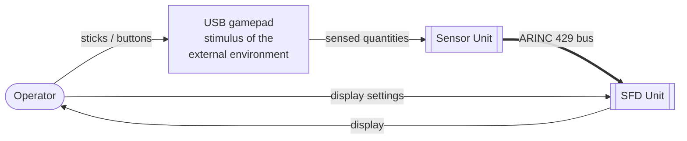
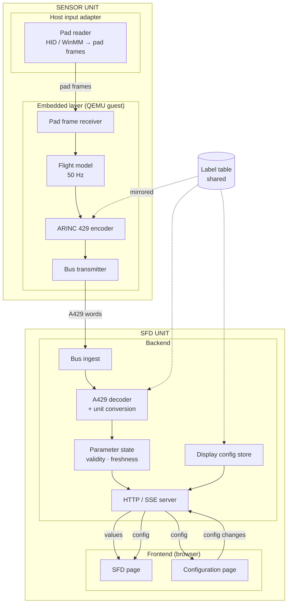
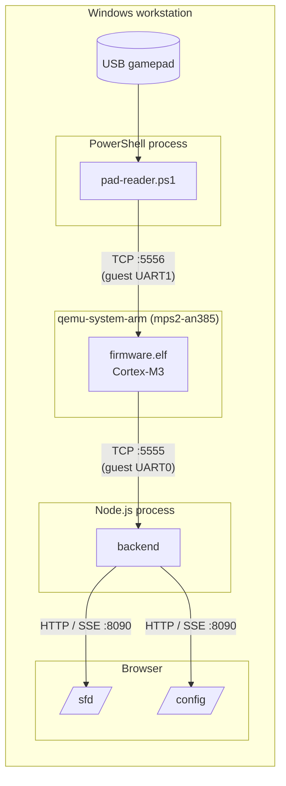
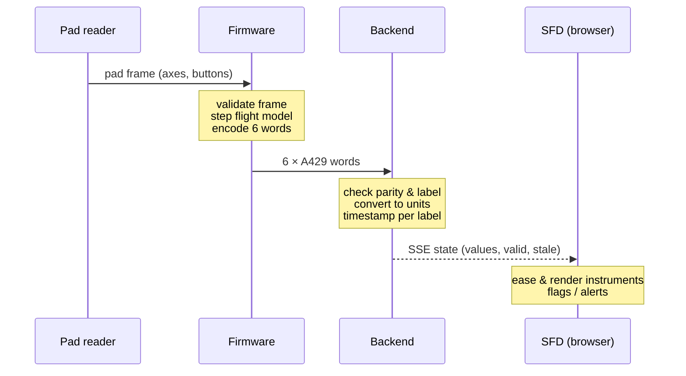
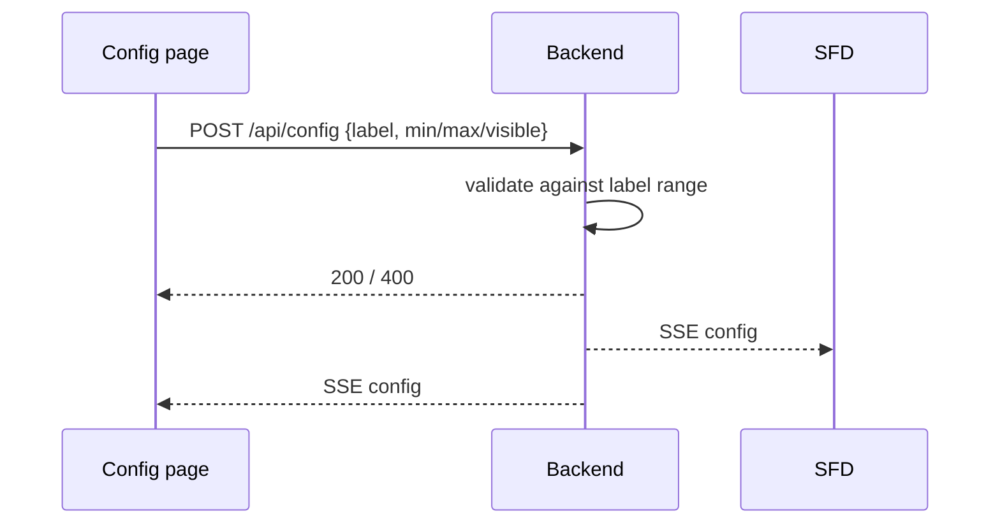

# Software Design Document — Gamepad-to-SFD Avionics Pipeline

| Field | Value |
|---|---|
| Document ID | SDD-SYS-001 |
| Revision | A (Draft) |
| Date | 2026-10-30 |
| Baseline | branch `sandbox`, commit `6f1ebd3` |
| Level of detail | Architectural — component responsibilities, boundaries and interactions. Detailed interface definitions are in `ICD-FW-BE-001`. |

---

## 1. Purpose and scope

This document describes the architecture of the complete solution: a physical gamepad
drives a simulated avionics computer, which publishes flight parameters over an
ARINC 429 link to a ground-side backend, which feeds a Secondary Flight Display (SFD)
and a display-configuration page in the browser.

It covers the three software layers — **embedded**, **backend**, **frontend** — plus the
host-side input adapter and the tooling that ties them together.

Architecturally, the solution is modelled as **two avionics units connected by an
ARINC 429 bus**:

- a **Sensor Unit** — the gamepad mimics the external physical quantities a real sensor
  would measure; the embedded firmware acquires them and transmits them as A429 data;
- an **SFD Unit** — the backend and frontend together form the display device that
  receives the A429 data and presents it to the crew.

---

## 2. System context

| Actor | Role |
|---|---|
| Operator | Flies the simulated aircraft with the gamepad, watches the SFD, tunes the display |
| USB gamepad | Stands in for the external environment: its axes and buttons mimic the physical quantities the sensor measures |
| Web browser | Hosts the SFD Unit's display surfaces (SFD page and configuration page) |

### 2.1 Unit decomposition

| Unit | Real-world equivalent | Made of | Input | Output |
|---|---|---|---|---|
| **Sensor Unit** | An attitude / air-data sensor LRU | Host pad reader (acquisition front-end) + bare-metal firmware in QEMU (processing and A429 transmitter) | External quantities (mimicked by the gamepad) | ARINC 429 words, 6 labels |
| **SFD Unit** | A Secondary Flight Display LRU | Backend (A429 receiver, decoder, validity monitor, display config) + frontend (SFD and configuration pages) | ARINC 429 words | Display to the crew |

The A429 bus (IF-3) is the only connection between the two units. Neither unit has any
knowledge of the other's internals: the SFD Unit sees only a compliant A429 source, and
the Sensor Unit sees only a bus to transmit on.

---

## 3. Architectural drivers

| Driver | Consequence on the design |
|---|---|
| Realistic embedded layer | Bare-metal Cortex-M3 firmware running in QEMU, not a simulated process on the host |
| Industry-standard avionics bus | Firmware emits bit-exact ARINC 429 words |
| **Decoupling** of backend from embedded | The A429 byte stream is the only coupling; the backend works from a recording with no firmware present |
| Single source of truth for values | Only the firmware produces flight values; the backend and frontend never compute or override them |
| Certification-minded backend | Backend limited to decode, unit conversion and validity — no filtering or derivation |
| Zero external dependencies | Plain Node.js, PowerShell/.NET and the ARM toolchain; no package installs |
| Hackathon time box | Capture-first build order; each layer testable in isolation |

---

## 4. Logical architecture

### 4.1 Component responsibilities

Unit mapping: **Host** and **Embedded** rows belong to the Sensor Unit; **Backend** and
**Frontend** rows belong to the SFD Unit; the **Shared** label table is the bus
definition both units are built against.

| Layer | Component | Responsibility | Does **not** |
|---|---|---|---|
| Host | Pad reader | Polls the gamepad, normalises axes/buttons, streams pad frames at 50 Hz | Interpret flight meaning |
| Embedded | Pad frame receiver | Validates and unpacks pad frames | Trust unvalidated input |
| Embedded | Flight model | Turns rate commands and buttons into six flight parameters; owns FREEZE | Know about transport or display |
| Embedded | ARINC 429 encoder | Converts each value to a 32-bit word (label, BNR, sign/status, parity) | — |
| Embedded | Bus transmitter | Emits the six words every frame on the serial port | Know who receives them |
| Backend | Bus ingest | Accepts the A429 byte stream (live socket or recording), keeps word alignment | Know QEMU, firmware or gamepad |
| Backend | Decoder | Validates words, converts BNR to engineering units | Filter, smooth or derive |
| Backend | Parameter state | Holds latest value per label, judges validity and staleness, counts errors | Invent values |
| Backend | Display config store | Holds per-parameter display window and visibility, validates changes | Change flight values |
| Backend | HTTP / SSE server | Serves the pages, REST config API, push streams, health | Business logic |
| Frontend | SFD | Renders attitude, heading, altitude, airspeed, vertical speed; annunciates invalid data; aural alerts | Compute flight quantities |
| Frontend | Configuration page | One control group per parameter to tune the SFD | Override values |
| Shared | Label table | Defines the six parameters (label, unit, resolution, range, display defaults) | — |

---

## 5. Physical / deployment view

Everything runs on a single Windows workstation, on loopback only.

In this simulated deployment both units share one workstation. The Sensor Unit is the
PowerShell process plus the QEMU process; the SFD Unit is the Node.js process plus the
browser. Only the TCP :5555 link (the A429 bus) crosses the unit boundary.

| Node | Technology | Notes |
|---|---|---|
| Pad reader | PowerShell + .NET interop (HID, WinMM fallback) | Listens; QEMU connects to it |
| Embedded | C, Arm GNU toolchain, bare-metal superloop, QEMU `mps2-an385` | Writes to UART registers only — unaware the UART is a socket |
| Backend | Node.js ≥ 22, standard library only | Listens for the bus and for HTTP |
| Frontend | Static HTML/CSS/ES modules, SVG, Web Audio | Served by the backend |

---

## 6. Interfaces (summary)

| ID | From → To | Medium | Content | Rate |
|---|---|---|---|---|
| IF-1 | Gamepad → pad reader | USB HID / WinMM | Axes, buttons, hat | device-driven |
| IF-2 | Pad reader → embedded | TCP → guest UART1 | Pad frame: sync, sequence, 4 axes, buttons, hat, checksum | 50 Hz |
| **IF-3** | **Embedded → backend** | **TCP ← guest UART0** | **ARINC 429 words, 6 labels** (see ICD-FW-BE-001) | **50 Hz frames** |
| IF-4 | Backend → browsers | HTTP SSE | Values + validity + stats; display config | ~50 Hz; on change |
| IF-5 | Config page → backend | HTTP REST (JSON) | Display-window / visibility changes, reset | on user action |
| IF-6 | Recording → backend | File | Same byte format as IF-3 | replayed at 50 Hz |

IF-3 is the **architectural seam** and the only **inter-unit** interface (Sensor Unit →
SFD Unit). IF-1 and IF-2 are internal to the Sensor Unit; IF-4 and IF-5 are internal to
the SFD Unit; IF-6 substitutes a recorded Sensor Unit. Everything to the left of IF-3 can
be replaced (real sensor hardware, another simulator, a recording) without changing
anything to its right.

### 6.1 Flight parameters carried on IF-3

| Parameter | A429 label (octal) | Source in the flight model |
|---|---|---|
| Pitch | 324 | Stick Y, rate-commanded |
| Roll | 325 | Stick X, rate-commanded |
| Heading | 314 | Derived from roll (coordinated turn) |
| Baro altitude | 204 | Derived from vertical speed |
| Calibrated airspeed | 206 | Throttle Z, rate-commanded; LB/RB steps |
| Vertical speed | 212 | Derived from airspeed and pitch |

---

## 7. Dynamic view

### 7.1 Normal operation — one 20 ms frame

### 7.2 Display configuration change

### 7.3 Validity paths

| Situation | Firmware | Backend | SFD |
|---|---|---|---|
| Normal | Valid sign/status | value, valid | instrument shown |
| FREEZE (Start button) | All labels "No Computed Data" | fresh but invalid | flags, value blanked |
| Bus silent > 250 ms | — | label stale, invalid | flags, "A429 LOSS" warning |
| Corrupt word | — | rejected, counted, state unchanged | unaffected |

---

## 8. Operating modes

| Mode | Started with | Running components | Purpose |
|---|---|---|---|
| Full | `npm start` | Pad reader + QEMU + backend | Live flying |
| No pad | `run-all.mjs --no-pad` | QEMU + backend | Firmware holds default state |
| Replay (decoupled) | `npm run start:replay` | Backend only, from `shared/capture.a429` | Demonstrates and tests decoupling |

Start-up order is driven by connection roles: listeners (backend, pad reader) start
first, then QEMU connects to both.

---

## 9. Key design decisions

| # | Decision | Rationale | Trade-off |
|---|---|---|---|
| D1 | Bare-metal firmware in QEMU | Real cross-compiled embedded code, portable to hardware by changing the serial backing | Board bring-up effort; no real-time guarantees under emulation |
| D2 | Pad input via host reader over a virtual serial port (no USB passthrough) | Simple, OS-independent guest; firmware sees a UART | Extra host process |
| D3 | ARINC 429 framed as 4 bytes per word over a byte stream | Bit-exact words without modelling the electrical layer | No bit timing, no inter-word gap |
| D4 | Backend decoupled at the A429 seam | Testable without hardware; clear responsibility boundary | Backend cannot diagnose upstream faults beyond validity/staleness |
| D5 | Backend does decode + convert + validity only | Keeps it simple and certifiable; avoids hiding bus problems | Any smoothing is pushed to the display layer |
| D6 | Sliders configure the display, never the value | Single source of truth; a slider cannot fake data | Less "demo control" from the browser |
| D7 | Server-Sent Events for push | One-way, native in browsers, no dependency | No back-channel on the same stream (REST used for changes) |
| D8 | Shared label table | One definition of parameters across layers | Firmware currently mirrors it by hand |
| D9 | Zero third-party dependencies | Nothing to install or audit beyond toolchains | More hand-written plumbing |
| D10 | Recorded capture as a first-class input | Frontend/backend progress independent of the embedded layer | Recording must be kept in step with the label table |
| D11 | Model the solution as two LRUs — Sensor Unit and SFD Unit — joined only by the A429 bus | Mirrors real avionics integration; each unit can be developed, verified and replaced independently | Gamepad and pad reader are a stimulus, not a real sensor front-end |

---

## 10. Quality attributes

| Attribute | How the architecture addresses it |
|---|---|
| Modifiability | Layers interact only through IF-2, IF-3, IF-4/5; any layer is replaceable behind its interface |
| Testability | Unit tests per layer, golden A429 vectors, firmware-in-QEMU harness, end-to-end and decoupled replay tests |
| Safety / integrity (display) | Parity and label checks, per-label freshness watchdog, explicit invalid annunciation; no value synthesis downstream of the firmware |
| Performance | 50 Hz end-to-end; < 1.5 kB/s on the bus; browser eases between frames |
| Security | All sockets on loopback; static file serving confined to `frontend/`; config input validated |
| Portability | Firmware writes hardware registers only; backend is platform-neutral Node; host reader is Windows-specific |

---

## 11. Source organisation

| Folder | Unit | Layer / role |
|---|---|---|
| `firmware/` | Sensor Unit | Embedded layer: sources, linker script, build script |
| `host/` | Sensor Unit | Host input adapter (pad reader and diagnostics) |
| `backend/` | SFD Unit | Backend: ingest, decoder, state, config, server |
| `frontend/` | SFD Unit | SFD and configuration pages |
| `shared/` | Bus definition | Label table, golden vectors, A429 capture |
| `tools/` | — | Orchestration (`run-all`), capture, QEMU harnesses, probes |
| `test/` | — | Automated tests |
| `docs/` | — | Plan, architecture notes, demo script |
| `documents/` | — | Controlled design documents (this SDD, the ICD) |

---

## 12. Architectural risks and open points

| # | Item | Impact |
|---|---|---|
| R1 | Label table is mirrored by hand into the firmware | Layers can silently disagree on scaling |
| R2 | Non-A429 start-up text shares the bus channel with A429 words | Possible loss of the first frame after reset |
| R3 | QEMU does not reconnect if the backend restarts | Live link lost until full restart |
| R4 | Host input adapter is Windows-only and device-specific (HID ranges, hat encoding) | Portability; some controls may misbehave on other pads |
| R5 | No firmware-side check against the golden A429 vectors | Encoder equivalence shown only indirectly |
| R6 | Emulated timing (host timers, QEMU) | Rates are nominal, not deterministic |

---

## 13. Related documents

| ID | Title |
|---|---|
| ICD-FW-BE-001 | Interface Control Document — Embedded Firmware ↔ Backend |
| `docs/PLAN.md` | Agreed plan and requirements |
| `docs/ARCHITECTURE.md` | Architecture rationale notes |
| `docs/DEMO.md` | Demo script |
